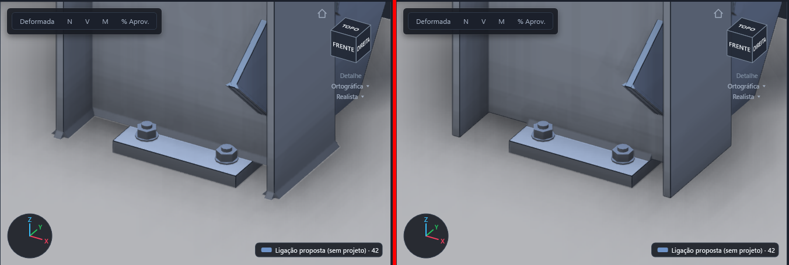
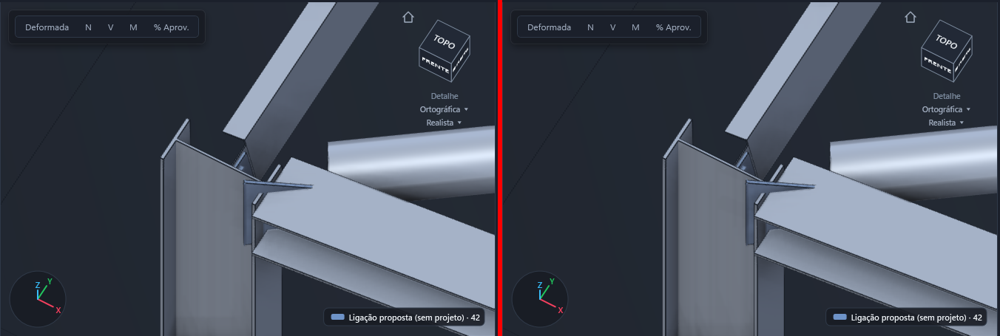
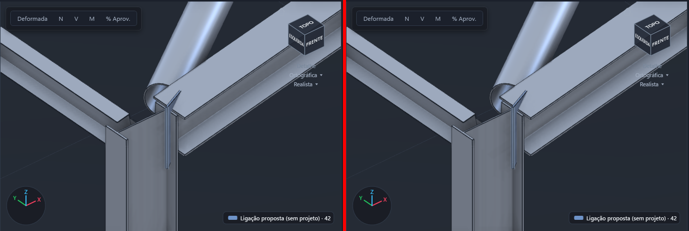
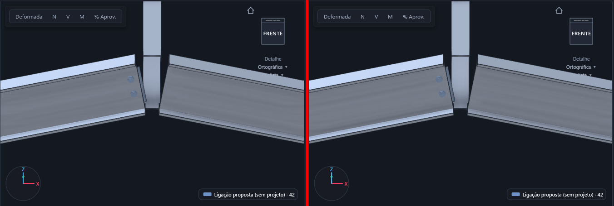
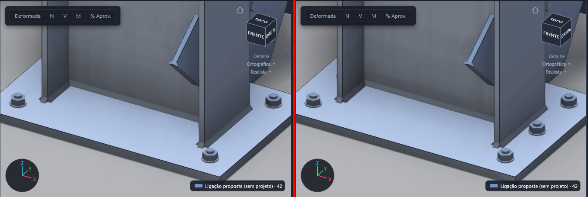

# Geometria das ligações no Realista: solda, enrijecedores, topo do pilar, placa deitada

Data: 22/10/2026. Branch `wt-geo`. Pedido: capturas do Realista com solda passando da chapa, enrijecedor "oco" e sem solda,
chapa/enrijecedor acima do topo do pilar, chapa sobrando além do perfil e placa de base deitada.

Capturas: `ESTRUCTTO_CAPTURAS=geo` (`CapturasGeo.cs`, `61-geo-*`). As imagens abaixo mostram antes à esquerda e depois à direita.

## 1. Solda só onde existe chapa

**Cálculo (motor, `placa_base._solda`)**

- Antes, o contorno soldado era sempre o perfil inteiro: L = 2·(b + d).
- Agora, com `pelo_perfil` falso e H, B informados, a chapa pode ser menor que o perfil. Nesse caso o retângulo soldado fica limitado a min(perfil, chapa) em cada direção (d ao longo de H, b ao longo de B; no eixo fraco, trocados). Isso vale para L, para a área e para a inércia.
- Tubo circular maior que a chapa: usa-se o círculo inscrito na chapa, raio = min(H, B)/2. É a favor da segurança.
- O resultado ganha `recortada` e um aviso.
- Com `pelo_perfil` verdadeiro, ou com chapa maior que o perfil, nada muda. Todos os casos antigos ficam iguais.
- Critério: a solda só transmite esforço onde assenta na chapa. O trecho no ar não existe.
- Teste: `testes/test_geometria_ligacoes.py`. O exemplo dá 640 mm em vez de 900 mm.

**Desenho (`Ligacao3D.Apoio` + `Render3DGeometria.Cordao`/`Intervalos`)**

- O cordão que assenta na face de uma chapa não paralela à barra (placa de base, chapa de topo) é recortado pelo contorno dela.
- O teste usa o pé da perna, meia perna para fora. Assim some também o filete da borda da mesa quando a chapa é rente ao perfil.

## 2. Enrijecedores fechados e soldados

- **Bug da chapa "oca".** `MalhaDx.Chapa` decidia a orientação das tampas pelo sentido do contorno. Mas `Triangular` já devolve os triângulos sempre anti-horários. Resultado: um contorno horário (por exemplo, o enrijecedor do pilar do lado −y) saía com as duas tampas viradas para dentro. Com o descarte de faces de trás, via-se o interior da chapa. Agora as tampas dependem só de (u × w)·n.
  - Autoteste: "chapa de contorno horário… para fora".
- **Solda de borda.** O motor manda o cordão do enrijecedor no plano médio da chapa. Antes, o filete era desenhado ali: ficava dentro da chapa. E o cordão paralelo à barra nem aparecia, porque o produto vetorial com o eixo da barra é nulo.
  - `Ligacao3D.Apoio` reconhece a solda na borda de uma chapa: as pontas e o meio estão no contorno, dentro da espessura.
  - As pernas vão pela chapa (para dentro dela) e pela peça de apoio (±normal).
  - A raiz fica na face da chapa, deslocada meia espessura.
  - Autoteste: "solda de enrijecedor…".
- **Motor.** O `enrijecedor da chapa de topo` (`ligacoes_rigidas`) não tinha solda na geometria. Ganhou dois filetes: um na chapa de topo e um na mesa da viga.
  - Perna: filete mínimo, como no enrijecedor do pilar. É só desenho; a solda não é dimensionada (já era assim, com aviso).
  - Teste: `test_enrijecedor_da_chapa_de_topo_tem_solda`.

## 3 e 4. Topo do pilar e chapa no lugar certo

- **Viga com chapa de topo no topo do pilar (joelho).** O pilar sobe até o topo da chapa de topo, menos `folga_topo`.
  - `folga_topo` é opcional, em mm, na `geometria` do contrato (`Ligacao3D.FolgaTopo`). O padrão é 0, ou seja, alinhado.
  - Antes, o pilar ia só até o canto da viga (v0.6 A1). A extensão da chapa estendida (com parafusos) e o enrijecedor da mesa de cima ficavam soltos acima do pilar (imagens 4 e 5 do pedido).
  - Só vale para pilar vertical que termina no nó e fica abaixo dele. Corte de esquadria ou do motor nesse topo não é alterado.
  - O autoteste `v0.6 A1: joelho` passou a exigir "pilar até o topo da chapa" e continua exigindo que cubra o canto da viga.
- **Proposta de cumeeira (`LigacoesAmostra.Cumeeira`).** A chapa fica ajustada ao perfil + `SobraCumeeira` (10 mm, parâmetro), com parafusos só entre as mesas.
  - Antes, a chapa era estendida 60–80 mm acima e abaixo da viga, sem viga atrás (imagem 3).
  - A chapa estendida do motor (`chapa_topo_estendida`) continua como o motor calcula. O que muda é que agora o pilar a acompanha.

## 5. Placa de base deitada (eixo fraco)

O que ficou suportado:

| Onde | O quê |
|---|---|
| Motor | `eixo_fraco` (já existia): H na largura do perfil, chapa e solda giradas. A solda recortada (§1) respeita a troca. Teste `test_eixo_fraco_troca_as_direcoes` |
| 3D (`Render3DMotor`) | Lê `eixo_fraco` do projeto do grupo → `PlacaDeBase(…, deitado)`. Furos por `fileiras` × `por_fileira`, como em `geometria_placa`, em vez de 4 cantos fixos. `pelo_perfil` ausente no projeto = falso, como no motor; antes o 3D supunha verdadeiro e desenhava outra placa. Proposta sem projeto = verdadeiro, como o sugerir |
| Janela da placa | Caixa "Placa deitada (girada 90°…)". `PlacaBase.EixoFraco` ↔ `eixo_fraco` em `PlacaMotor` |
| Nucleo.cs (legado/desenho 2D) | `ResPlaca.Deitado = pilar.EixoFraco ≠ placa.EixoFraco` e `RefIn`/`RefOut` trocados. Padrão falso: os resultados antigos não mudam. Teste novo no `Testes.cs` (242 passam) |
| Barra inclinada | `AssentarPlaca` com a placa deitada: as sobras continuam pareadas com B e H do perfil |
| Placa vertical contra parede | Barra horizontal com apoio: a placa já é ⟂ à barra no referencial local (vertical) e os chumbadores vão ao longo da barra |

## 6. Gusset de diagonal desenhado pelo Estructto (gusset local)

O gusset local é o `LigacoesAmostra.Gusset`. Ele é usado nas propostas sem projeto, nas capturas e no projeto `ligacao_tracao` de um nó de gusset ou treliça. A geometria do motor para `ligacao_tracao` é esquemática: uma chapa que começa no nó, sem perfil. Por isso o Render3DMotor troca essa geometria pelo gusset local, com t, d, nº de parafusos e passo do projeto.

A referência é o Advance Steel. A chapa fica no plano formado pela diagonal e pelo apoio, soldada em toda a borda reta na face do apoio. A diagonal encosta numa face dela, e os parafusos ficam só no trecho em que a diagonal está sobre a chapa, contados a partir da ponta da diagonal.

Regras aprendidas (23/10/2026, cada uma veio de um defeito real):

| # | Regra | Defeito que ela corrige |
|---|---|---|
| 1 | O plano da chapa é o da diagonal com o eixo do apoio. O Render3D gira o referencial em torno da diagonal (y' = x × apoio⊥) e não desloca a origem: o gusset local já vem na face da peça. | A chapa ficava no referencial da diagonal, girada e no eixo do pilar. Depois, o deslocamento do contrato do motor (que supõe a chapa centrada) a punha no meio da alma do W e afundava os parafusos. |
| 2 | A borda soldada fica ∥ ao eixo do apoio (`x = xb − w·sx/sz`). Os filetes acompanham. | A borda ⟂ à diagonal tocava o pilar só por um canto. |
| 3 | `FolgaGusset` empurra a chapa para fora das peças do nó, e as soldas da chapa vão junto (`deslGusset`). | As soldas ficavam onde a chapa estava antes do empurrão, soltas dentro do pilar. |
| 4 | A ponta da diagonal vem da regra das juntas (`Corte.Recuo`, contado do nó). O gusset não grava recorte. | O recuo ia como `Folga`, que é o vão a partir da face: a diagonal recuava a face a mais e os parafusos ficavam fora dela. |
| 5 | A diagonal recua a seção inteira, não só o eixo: `recuo += Saliencia`, que é o máximo de `−p·f/(d·f)` no contorno, com f a normal da face que o eixo cruza. Vale na `Juntas` e na `JuntasV04`, e o teste compara as duas. | Com o corte ⟂ à barra, o canto da mesa de baixo entrava no pilar. |
| 6 | Face onde a chapa encosta: se o plano do gusset é ⟂ a u, vale `FaceChapa` (alma do I, costas do U e do L, lado do tubo). Se é ⟂ a v (`NormalEmV`), vale `FaceChapaV` (mesa do I e do U, lado H do tubo, costas da outra aba do L) e o Render3D lê o y do gusset como v (`FaceV`). | A chapa ia num lado fixo do perfil, qualquer que fosse a posição da diagonal. |
| 7 | I/W com a alma no plano: a chapa encosta na alma e, a partir da ponta da diagonal, tem meia largura h/2 − tf − 10. Ela só alarga antes da ponta, até a borda soldada. I/W com as mesas no plano: a chapa encosta na face externa da mesa, com a linha de parafusos a B/4 do eixo, fora da alma, e a pega = tf. | Por fora da ponta das mesas não há alma para os parafusos, e com a largura do perfil todo a chapa atravessava as mesas. |

Provas:
- `42-realista-ligacao-gusset-pilar-meio{,-w,-u,-tubo}` (frente, iso e trás): diagonal de L, W, UPN e tubo chegando no meio de um pilar W.
- `ESTRUCTTO_CAPTURAS=modelo` mais `--capturas <pasta> <arquivo>` renderiza um modelo qualquer: vista iso, mais frente, iso e três vistas de perto da borda soldada em cada nó com ligação.
- Asserção `ligacoes3d: gusset ...` no `--testes-exportar`.

Ainda falta:
- O gusset do motor (`gusset_contraventamento`, com `apoio_dir`) segue o contrato do motor. Nenhuma das regras acima foi aplicada a ele.
- Parafusos de `ligacao_tracao` com várias linhas saem numa linha só ao longo da diagonal.
- W como diagonal com as mesas no plano do pórtico (captura `-w90`): a chapa encosta na mesa, a h/2 do plano, e passa da largura da mesa do pilar. Fica ao lado do pilar, sem onde soldar. O detalhe certo é outro: chapa no plano central, com rasgo na alma da diagonal ou a diagonal girada. Não implementado.
- O recorte da mesa da diagonal em W para a chapa entrar mais (o snipe do Advance Steel) não é feito. A chapa estreita entre as mesas.

## 7. Bateria de interferência das ligações locais (`interf3d`)

Data: 23/10/2026. Pedido: gusset de W ainda bugado e nó de pilar com 4 vigas cheio de sobreposições; "testar todas as possibilidades até ficar certo".

`ESTRUCTTO_CAPTURAS=interf3d` mais `--capturas <pasta>` (`CapturasInterf.cs`) monta 2.958 cenas pequenas sem motor, com as ligações locais (`LigacoesAmostra`), e roda o mesmo detector do `--testes-interferencia` (pares que se interpenetram > 1 mm). Grava `interf3d.txt` e captura iso/trás só das cenas reprovadas. O código de saída é o nº de cenas reprovadas. `ESTRUCTTO_INTERF=<trecho do nome>` roda só as cenas que o contêm, captura também as aprovadas e põe a caixa (mm) de cada sólido no relatório.

| Família | Combinações |
|---|---|
| `cruz` | pilar (W250, W200, W310, HP250, tubo 100×50, tubo 150×150, U 8") × giro 0/90 × viga (W310, W200, W410, U 8", tubo) × cardinal 5/8 × topo/meio × lados (4, mesas, almas, 1x, 1y, L, 3) |
| `mista` | vigas da mesa e da alma com perfis e cardinais diferentes (alturas misturadas no nó) |
| `diag` | pilar (W250, W310, tubo 100×50, tubo 150×150) × giro × diagonal (L, W310, W200, U 8", tubo retangular, tubo redondo) × giro × 5 geometrias (45°, outro lado, rasa, íngreme, subindo) × com/sem viga no nó |
| `portico2x2` | pórtico 2×2 com e sem contraventamento em X |

Seção fora do catálogo reprova a bateria (o "UPN 200" das capturas antigas virava perfil genérico 70×70 e não testava nada; agora `U 8" x 17,1`). Barras sem nó em comum que se cruzam (X de cantoneiras sem nó no meio) são choque do modelo, não da ligação: saem à parte e não reprovam.

Defeitos achados e corrigidos (733 → 32 reprovadas):

| # | Defeito | Correção |
|---|---|---|
| 1 | Enrijecedor do pilar (chapa de topo) com meia largura max(B, H)/2 − tf: passava ~50 mm da mesa e batia nas vigas da alma; uma chapa só atravessava a alma | Dois enrijecedores por nível, da face da alma (tw/2) até a ponta da mesa (B/2) (`ChapaDeTopo`, `twPilar`) |
| 2 | Pilar contínuo (nó no meio) subia até o topo da chapa de topo e entrava no trecho de cima | A regra "pilar até o topo da chapa" só vale se nenhuma barra vertical sobe do nó (`Render3D`) |
| 3 | Viga na alma do pilar com enrijecedores no nó entrava entre as mesas (regra de viga em viga, com cope) e batia nos enrijecedores | Com enrijecedor no nó: a viga para na ponta das mesas e a chapa simples vai da face da alma até ela (chapa estendida). Sem enrijecedor fica a regra antiga (entra até 12 mm da alma) |
| 4 | Chapa simples × enrijecedor quando as alturas ou os cardinais diferem | A chapa vai para a maior faixa livre entre os enrijecedores dentro da altura dela, descentrada se preciso (`Enrijecedores`) |
| 5 | **Gusset de W com a alma no plano (o da imagem do pedido):** a borda soldada partia de xb = 0,4·xr e o `FolgaGusset` empurrava a chapa até a face; no lado agudo a ponta da borda passava de xr e a chapa entrava na mesa da diagonal (5 mm) | A borda é calculada direto na face do apoio, x(z) = (a0 − z·az)/ax, e a ponta fica em x ≤ xr − 1, andando sobre a face |
| 6 | Diagonal no nó viga-pilar com a viga pendurada pela mesa (cardinal 8): `FaceDist` supunha o eixo da viga no nó e a diagonal entrava na viga | `RecuoDiag`: saída real do eixo da diagonal da caixa de cada peça (com o deslocamento entre os eixos) mais a saliência na face cruzada. Vale na `Juntas` e na `JuntasV04` |
| 7 | Gusset no nó viga-pilar-diagonal atravessava a viga e a chapa de topo (lado obtuso, +90 mm) | A chapa é recortada pelo semiplano de cada peça do nó no plano dela (caixa da peça + o que as chapas da ligação dela passam da caixa); os filetes são recortados junto |
| 8 | Gusset no pé do pilar atravessava a placa de base | Recorte pela face de cima da placa de base do apoio |

Restavam 32 cenas, todas pilar tubo 100×50 com 4 vigas W de mesa 140–165 mm (mais largas que a face do pilar): as vigas a 90° se cruzavam no canto. Decisão do usuário (26/10/2026): as vigas recuam até não se tocarem e não se propõe chapa.

| # | Defeito | Correção |
|---|---|---|
| 9 | Viga contra pilar mais estreito que ela cruzava as outras vigas do nó no canto | `Juntas` e `JuntasV04`: a viga (que não é contínua, contra pilar) recua também até sair da caixa das outras vigas não paralelas do nó (`RecuoDiag`) |
| 10 | Chapa proposta numa viga que não chega ao pilar | `Gerar` e `Proposta`: sem chapa quando a viga é mais larga que a face do pilar (`MaisLarga`, largura ⟂ às duas barras) **e** o recuo passa da face em mais de 30 mm. Só a largura não basta: W310 (mesa 165) em pilar W250 (mesa 146) é comum, a chapa de topo monta e continua proposta |

A bateria `interf3d` fica com 2.958/2.958 cenas aprovadas.

Provas desta rodada:
- `interf3d`: 2.958 cenas, todas aprovadas (2.926 antes das regras 9 e 10).
- `--testes-exportar`: 0 falhas.
- `--testes-interferencia` com o motor empacotado: galpão, edifício, pórtico, treliça, mezanino e `testes-aceite/PLATAFORMA.ed3`, todos com 0 pares. O teste aceita agora qualquer chave de modelo inicial, não só `galpao`.

## Provas

- Motor: `python -m unittest discover -s testes`, com 1211 testes OK, 9 pulados, 5 deles novos em `test_geometria_ligacoes.py`.
- Pórtico: `compilar.ps1 -Testes`, com 242 testes passando.
- `Estructto.exe --testes-exportar`: sem falhas. As asserções novas são `render3d:` chapa horária, solda recortada e cordão recortado, e `ligacoes3d:` solda de enrijecedor, placa menor e placa deitada.
- `--testes-interferencia galpao` com `ESTRUCTTO_MOTOR` do worktree: 0 pares.

## Pendências

- A placa vertical contra a parede não tem teste próprio. O motor calcula com os esforços locais da ponta e não diferencia piso de parede no bloco de concreto.
- O enrijecedor do pilar que fique acima de um pilar sem chapa de topo, por exemplo uma ligação só com enrijecedores, não é recortado. Hoje ele só sai do ar quando o pilar sobe junto com a chapa de topo.
- Solda da nervura da placa de base: o motor não tem nervuras na placa (PLACA-BASE-V2 §8, "Enrijecedores").
- `folga_topo` ainda não é campo do esquema do motor, só leitura opcional da `geometria`.
