# Realista "absurdo": Render3D (DX11) com recortes e ligações

Data: 21/10/2026. Branch `wt-render`. Código: `codigo/Estructto/Render3D.cs` (viewport DX11, materiais, luzes, sombra, SSAO,
chão, seleção, LOD, picking), `Render3DGeometria.cs` (malha, recortes nas juntas, extrusão com planos de corte, parafuso,
cordão, triangulação), `Render3DLigacoes.cs` (contrato `geometria` → `Ligacao3D`, exemplos à mão, placa de base do 2D),
`Render3DMotor.cs` (ligações dos grupos do motor). Integração na `Vista3D.cs`: `RealismoDx` + 6 linhas de gancho.
Decisão do renderizador e medições: [../VISTA3D.md](../VISTA3D.md).

## Antes e depois

Capturas `42-realista-*` (1280×720): `antes-*` = Realista nativo (Viewport3D, commit 7b6ee94); `depois-*` = Render3D.

| Modelo | Antes (nativo) | Depois (Render3D) |
|---|---|---|
| Guincho (2D, placa de base calculada) | 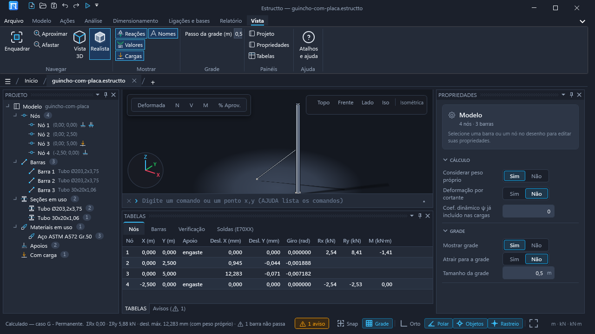 | 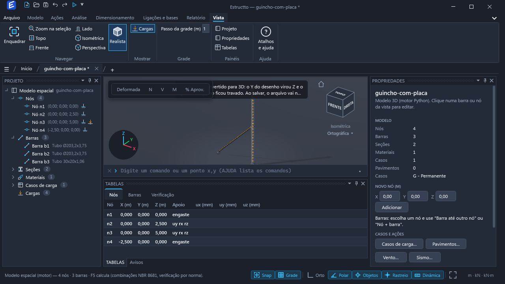 |
| Pórtico 2×2 | 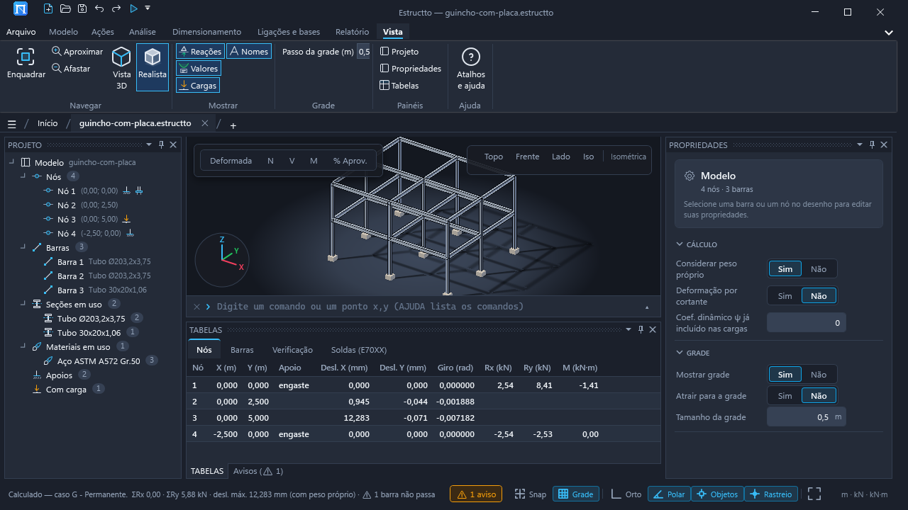 | 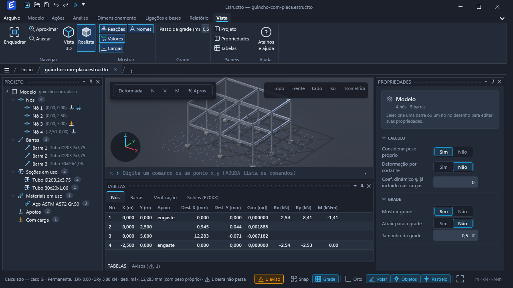 |
| Pórtico 2×2, detalhe | 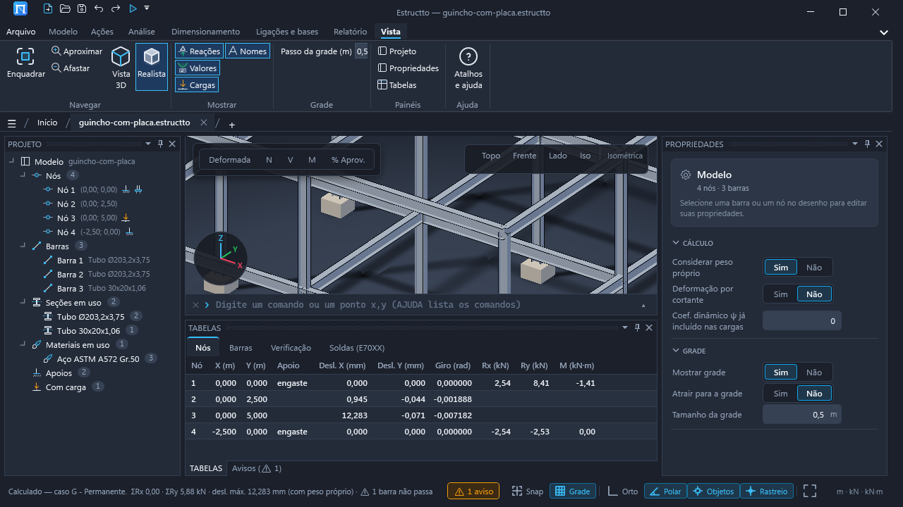 | 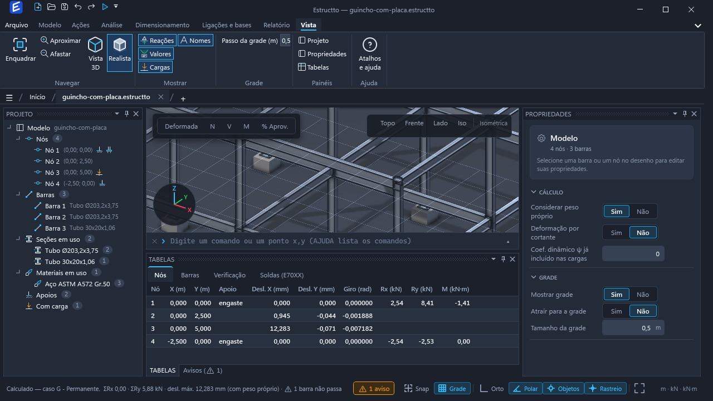 |
| `edificio_concreto` (motor) | 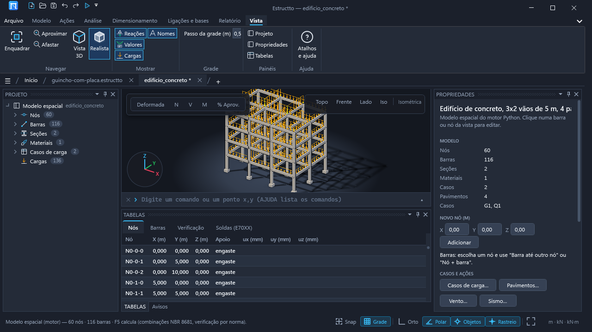 | 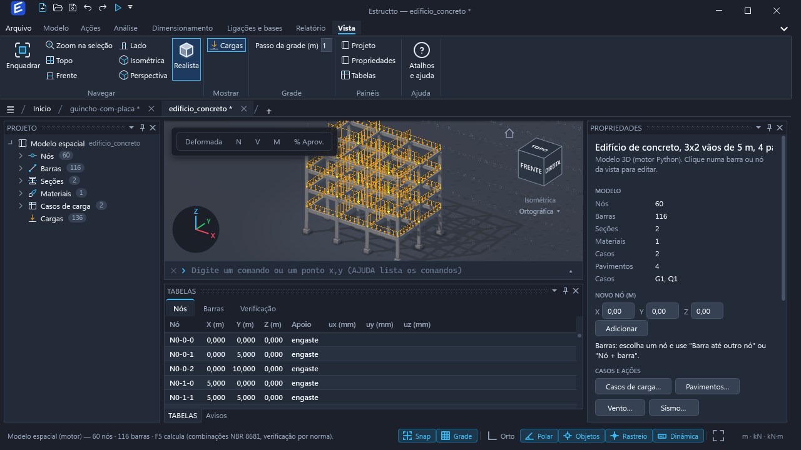 |
| `galpao_aco` (motor) | 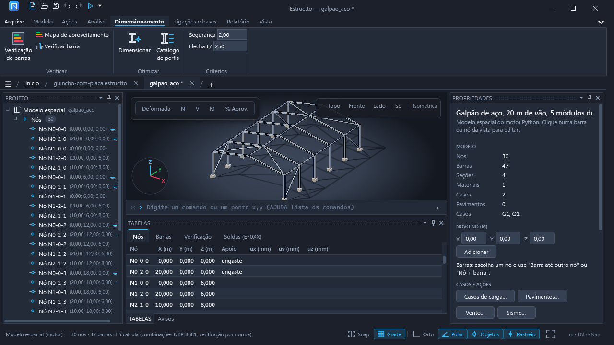 | 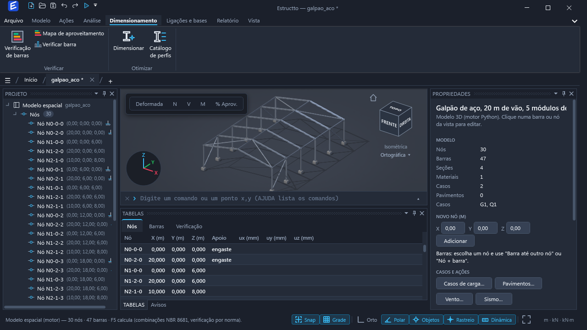 |

Só no Render3D (não existia antes):

| | |
|---|---|
| Chapa de topo viga-pilar com parafusos e enrijecedores (exemplo do contrato) | 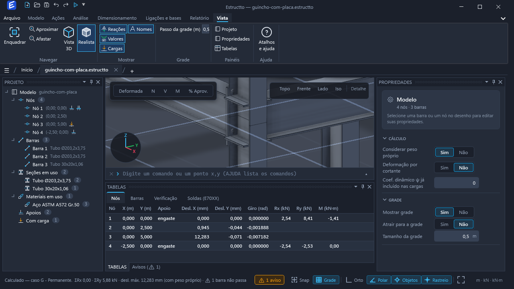 |
| Placa de base com chumbadores (exemplo do contrato) | 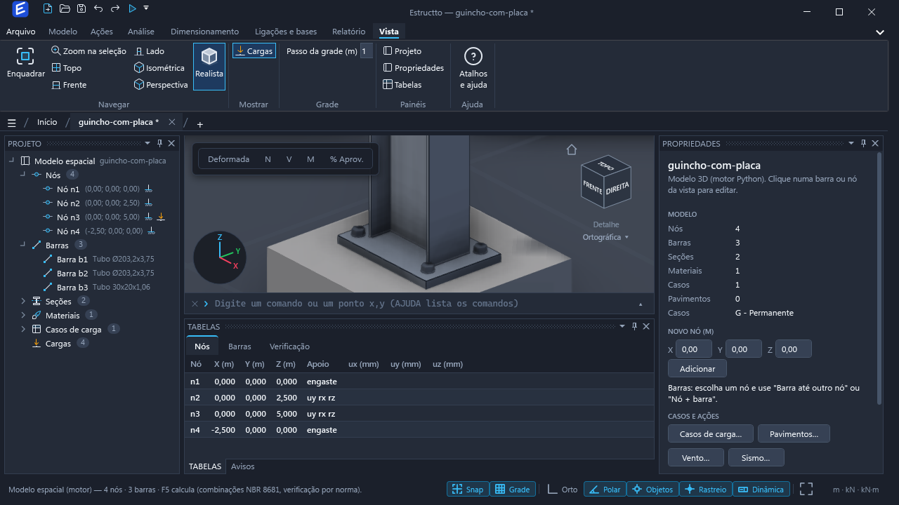 |
| Vão contraventado com gussets | 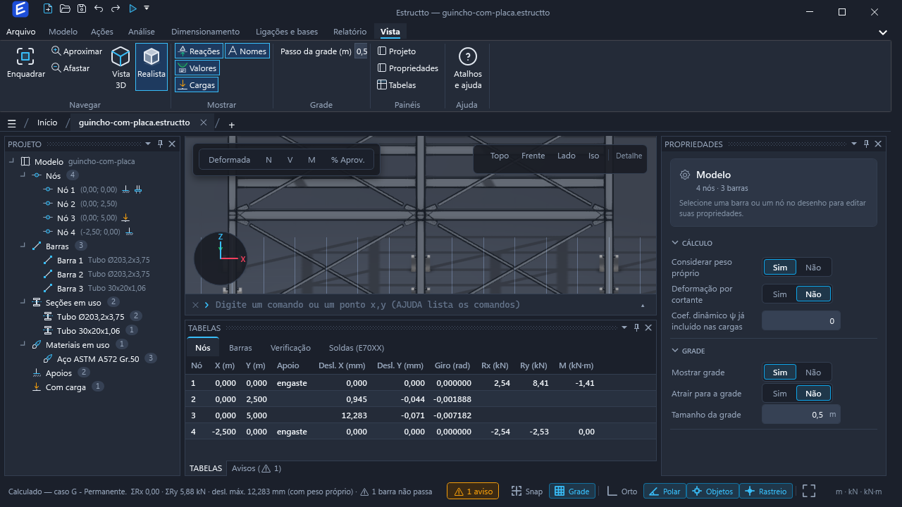 |
| Gusset, close-up | 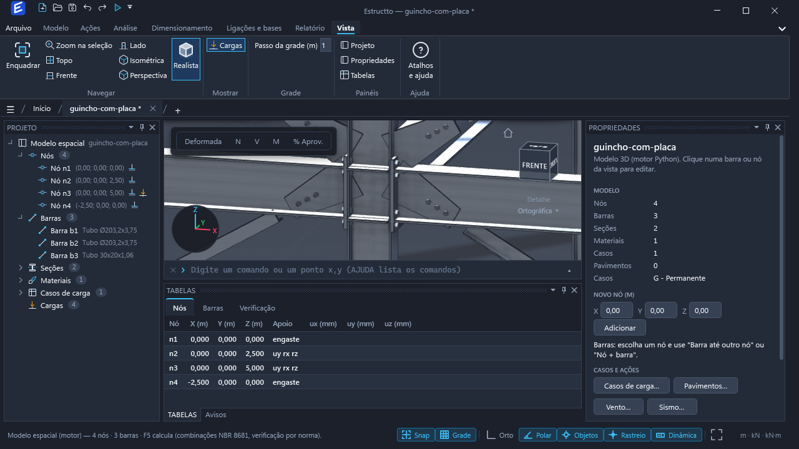 |
| Galpão com as ligações dos grupos do motor (`chapa_topo_estendida`, `chapa_simples_alma`, placa de base) | 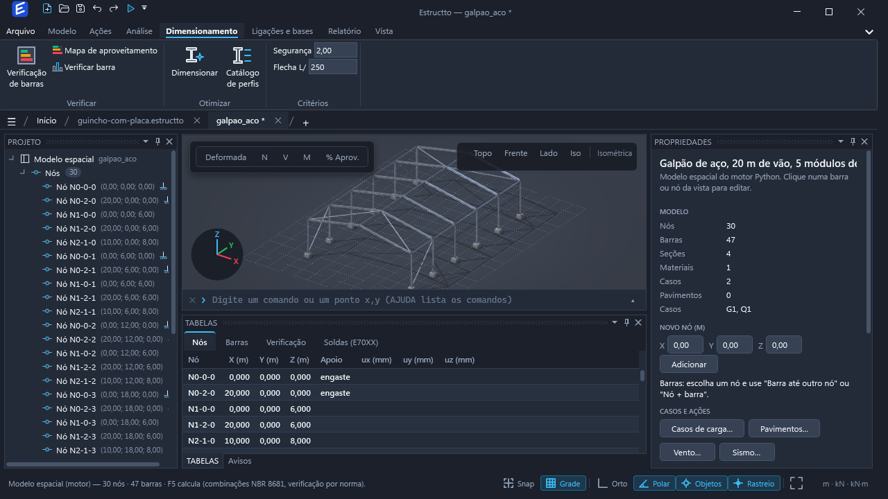 |
| Chapa de topo do motor (`verificar_ligacao`, geometria do contrato) | 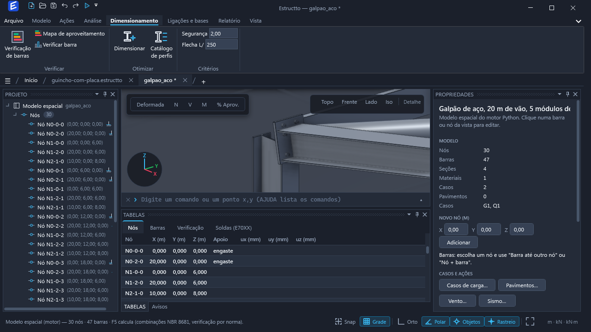 |
| Placa de base do grupo "base" do motor | 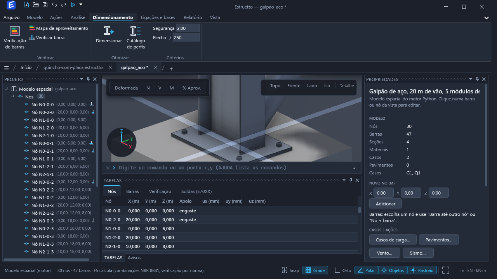 |
| Perspectiva (FOV 45°) com o ViewCube | 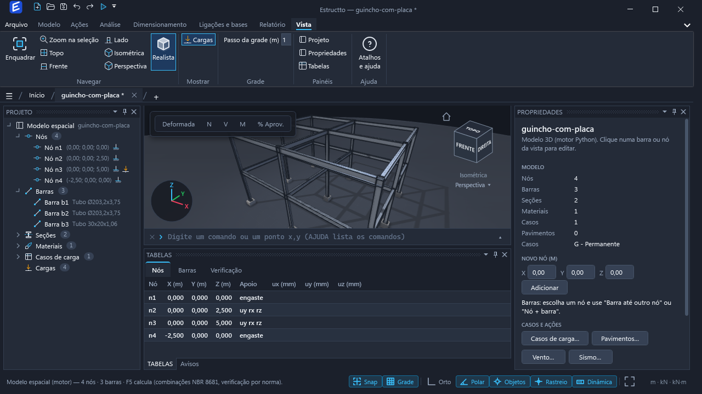 |

Julgamento honesto contra Tekla/Advance Steel/Revit: o nativo lia como "sombreado plano com sombra no chão", peças se
atravessando nos nós e sem anti-serrilhado nas capturas. O Render3D traz sombra entre peças, oclusão nas quinas, arestas de 1 px,
recortes e ligações: está no nível de um "Shaded with edges" do Revit com sombras. Depois (fix-render): mapa de ambiente,
cope e filete triangular também.

## O look

- **Luz de estúdio**: chave quente `#F2E8D6` (a mesma direção do Realista nativo: esquerda-alto da Iso, fixa no mundo),
  enchimento frio `#303A4C` do lado oposto, contraluz `#48546A` por trás, ambiente `#30343C`. A 1ª luz direcional é a da sombra.
- **Sombra**: `ShadowMap3D` 4096², intensidade 0,7, bias 0,0012, `AutoCoverCompleteScene` (o chão não projeta sombra).
- **Oclusão ambiente**: SSAO alto, raio = 0,9 × largura média das seções (0,12–0,6 m), intensidade 1.
- **Materiais PBR** com cor por vértice (`VertexColorBlendingFactor = 1`: o albedo é a cor do vértice, então o mapa de
  aproveitamento e a seleção tingem a peça sem trocar de material). Aço galvanizado (`CorAco3D`, metálico 0,12, rugosidade 0,5);
  `ESTRUCTTO_3D_ACO=pintado` (`CorAcoPintado3D`) ou `primer` (`CorPrimer3D`, vermelho-acinzentado fosco). Concreto
  (`CorConcreto3D`, rugosidade 0,9). Chapas `CorChapa3D`, parafusos `CorParafuso3D` (metálico 0,6), soldas `CorSolda3D`.
- **Exposição**: o PBR do Helix com as 3 luzes rende ~2,7 × o albedo numa face horizontal; as cores do `TemaPlant` são as
  cores-alvo na tela, então o albedo entra multiplicado por 0,42 (chão) e 0,6 (peças; faces verticais recebem menos luz).
- **Arestas**: `LineGeometryModel3D` de 0,9 px (`CorArestaDx3D`) nas arestas longitudinais e nos anéis das pontas (tubos só
  anéis), com MSAA 4× + FXAA. Somem quando a seção tem menos de 6 px na tela.
- **Chão**: disco com degradê radial `CorChao3D` → cor do canvas (o último anel, a 3 R, já é o canvas: a borda fica fora da
  tela) e grade `CorGrade3D` embutida na malha, um fio acima do chão, que esmaece com o raio. Opaco: o fundo transparente do
  D3DImage sai branco no `RenderTargetBitmap` das capturas, e a passagem transparente do Helix ignora a profundidade das peças.
- **Seleção**: peças escolhidas vão para uma malha própria com `PostEffectMeshOutlineBlur` (halo `CorBarraSel`, 1,2 ×, 1 passe)
  + tinta azul a 45%. O halo passa por cima de tudo (é um pós-efeito).
- **Aproveitamento**: 72% da cor da faixa (`CorCalor1..4`), o sombreado continua.
- **Tema escuro**: fundo do viewport = `BgCanvas`; a vista nativa (cargas, diagramas, nós, fantasmas) fica por cima, sem
  profundidade contra as peças (ponytail: setas e diagramas aparecem na frente das peças).

## Geometria

- **Seção**: `GeometriaPerfis.CriarContorno` (o mesmo da exportação DWG/STEP). A cópia que a Vista3D tinha foi apagada:
  `Vista3D.CriarForma` só acrescenta as normais (plana por aresta; radial nos laços lisos dos tubos).
- **Recortes nas juntas** (`Render3DGeometria.Juntas`): em cada nó, ranking pilar (|dz| > 0,95) > viga (|dz| < 0,2) > diagonal,
  desempate pela altura da seção e pelo comprimento. A peça de maior ranking é contínua (um par colinear do mesmo ranking é uma
  só peça). As outras param na face da caixa da seção de **todas** as peças de ranking maior (`FaceDist`: B/2 ou H/2 ao longo da
  direção da barra) + folga: 12 mm aço, 40 mm diagonal (espaço do gusset), 0 concreto. Dois banzos do mesmo ranking sem peça
  contínua (cumeeira, canto) = esquadria pela bissetriz (`Corte.Esquadria`: plano pelo nó com normal `d1 − d2`). Recuo limitado
  a 30% do vão. A extrusão (`Extrudar`) termina em planos de corte arbitrários: cada vértice do contorno anda ao longo da barra
  até o plano; as tampas vão junto.
- **Ligações** (`Ligacao3D`): o `geometria` do contrato (mm, referencial local: origem no nó, x = barra que chega saindo do nó,
  z = eixo forte = v da extrusão, **y = x × z**, que é canhoto — por isso o 2º eixo das chapas é `normal × u` calculado no
  local, antes de ir para o mundo, e a orientação dos triângulos é decidida pela mão do triedro no mundo). Chapas: polígono
  (triangulação por orelhas) extrudado de 0 a `espessura` ao longo da normal. Cantoneiras: `L<b>x<t>` extrudadas. Parafusos:
  cabeça sextavada + arruela, fuste, arruela + porca, numa malha só (ponytail: sem instancing; 2.430 barras com ~1.200 chapas
  de topo montam em 0,5 s). Soldas: filete triangular de pernas iguais (`Cordao`): uma perna ao longo da peça que chega (x local), a outra para fora do
  contorno (laço fechado, pela orientação) ou dos dois lados (cordão aberto).
  Recortes: `recuo` com `folga` (vão até a face) ou `x_ponta` (posição absoluta da ponta, como o motor manda); `cope` (`posicao`
  topo/base, `altura`, `comprimento` a partir da ponta): a ponta da viga é extrudada com o contorno cortado
  (`Render3DGeometria.Recortar`, só seções de laço único: I, U, L) e a peça cheia começa depois. O exemplo de chapa simples viga
  em viga entra até 12 mm da alma do apoio (`x_ponta`) com cope na mesa de cima (captura `42-realista-ligacao-cope`).
- **Origem das ligações**, por ordem: (1) `Modelo3D.Ligacoes` preenchido pelo modelo espacial: grupos do motor
  (`GET /api/ligacoes/grupos`) com projeto → `POST /api/ligacoes/verificar` por grupo (esforços nulos; `perfil_viga` = seção
  do membro, `perfil_pilar/suporte` = barra com `papel: pilar` no nó, senão a mais alta) → `geometria`; grupo "base" → placa pelo
  perfil (esquema padrão do motor: esp 19, borda 50, sobra 100 mm) com chumbadores. (2) Modelo 2D: `No.Placa` +
  `PlacaCalc.Calcular` → placa, furos e solda reais. (3) Sem nada: exemplos (`LigacoesAmostra.Gerar`, formato do contrato:
  chapa de topo estendida com 8 parafusos e enrijecedores, chapa simples, gusset, placa de base) só nas capturas ou com
  `ESTRUCTTO_3D_AMOSTRAS=1` — não aparecem para o usuário sem ele pedir, porque não são calculados.
- **Motor**: os tipos das três famílias do contrato entraram em `ligacoes_modelo.VERIFICADORES` (`_registrar_contrato`:
  esforços do solver → convenção do contrato, V = Vz local, M = My), senão `editar {acao: projeto}` recusava
  `chapa_topo_estendida` etc. Testes `test_ligacoes_modelo/rigidas/flexiveis/contraventamento` passam.
- **LOD**: parafusos e soldas só com ≤ 80 ligações ou quando a seção média tem ≥ 40 px; arestas com ≥ 6 px. Histerese e órbita parada: ver ../VISTA3D.md ("Parafusos, ligações propostas e linhas do analítico"). Atualizado a cada
  mudança de câmera (`Render3D.Lod`, só troca `Visibility`).
- **Pedestal**: bloco de concreto do apoio cresce para caber a chapa mais larga da ligação do nó + 40 mm.
- **Ponto cardinal** (`Barra3D.Cardinal`, docs/MODELO-ESPACIAL.md): `GeometriaPerfis.Cardinal(contorno, 1..10)` devolve o
  deslocamento (u, v) do perfil para o ponto escolhido ficar sobre o eixo da barra (teclado numérico olhando a seção com v para
  cima: 7-8-9 topo, 1-2-3 base, 4 = lado +u; 10 = centroide pelas tampas). Aplicado no Render3D, nos recortes, nas ligações
  (a origem local vai junto) e no Realista nativo; a exportação recebe `cardinal` opcional em `GeometriaPerfis.Extrudar`
  (DWG/STEP continuam no eixo até o exportador passar o valor). Nas capturas, as vigas do pórtico 2×2 estão no cardinal 8.
- **Câmeras**: ortográfica e perspectiva (`Render3D.Camera(perspectiva, …)` espelha a `OrthographicCamera`/`PerspectiveCamera`
  da Vista3D.Navegacao; o LOD usa px/m no plano do alvo).

## Picking, seleção, cargas, modo analítico

- `Vista3D.Acertar`: primeiro o `HitTest` nativo (nós escolhidos, setas não contam), depois `Render3D.Acertar` (`FindHits` do
  Helix, vértice → barra por busca binária nas faixas), depois o nó a 8 px, como antes. Chapas, parafusos e chão não são
  escolhíveis.
- Seleção múltipla, janela/cruzamento, Desenhar 3D, snap e Medir não mudaram: continuam na Vista3D (a malha DX fica abaixo do
  Viewport3D nativo, que só tem cargas, diagramas, nós e fantasmas no modo DX).
- Modo analítico e Realista nativo intactos (`ESTRUCTTO_3D=nativo` força o nativo; capturas `capturas-nativo` conferidas).

## Capturas e desempenho

`ESTRUCTTO_CAPTURAS=3d` (Capturas.CapturasRealista): além das antigas, `42-realista-ligacao-chapa-topo(-planta|-iso)`,
`-ligacao-placa-base`, `-contraventamento`, `-ligacao-gusset`, `-galpao_aco-ligacoes`, `-ligacao-motor-chapa-topo`,
`-ligacao-motor-placa-base`, `-2400barras-ligacoes`. `42-tempos.txt` (RTX 4060, 1600×900):

| | nativo (antes) | Render3D | Render3D + ~1.200 ligações de exemplo |
|---|---|---|---|
| 2.430 barras: carregar + enquadrar | 166 ms | 25–34 ms | 480–550 ms |
| montar a cena DX | — | 24–34 ms | 476–548 ms |
| quadro (1600×900, sombra 4096², SSAO alto, MSAA 4×) | — | 9,3–10 ms (~100 fps) | 9,4 ms |
| picking (centro da tela) | 8 ms | 4,7–5,6 ms | 5,6 ms |
| 2 capturas (RenderTargetBitmap) | 915 ms | 600–730 ms | 850–920 ms |

Autoverificação (`Estructto.exe --testes-exportar`): 12 asserções novas (`render3d:` juntas, esquadria, extrusão com corte,
triangulação; `ligacoes3d:` chapa de topo, ida e volta pelo JSON do contrato, placa de base).

## Pontas do motor e interferência (G4)

- `Ligacao3D.Ponta`: a ponta da barra que chega (`geometria.pontas`, `barra = 0`, contrato em [PONTAS-CONTRATO.md](PONTAS-CONTRATO.md)),
  lida no referencial local da ligação (m). O Render3D a converte para o mundo e passa a `Juntas(..., motor)`: o plano do motor
  manda (sem o limite 0,3·L), `cope` (sup/inf/esq/dir) vira trecho de contorno recortado (`Recortar` corta também em u),
  `angulo` vira 2º plano paralelo à face do apoio e `boca_peixe` vira o cilindro do receptor. Sem `pontas` (modelo antigo,
  ligação local, proposta que o motor não desenha): a regra das juntas de antes (Review Focus 3).
- `Corte.Extra` (2º plano) e `Corte.Raio/EixoO/EixoA` (cilindro): `Extrudar` corta cada aresta no mais fundo dos cortes.
  Também sem o motor: barra oblíqua ao apoio (diagonal, água do telhado) ganha o plano `angulo` (nenhum canto entra no
  apoio); tubo redondo em tubo redondo ganha a boca de peixe; a esquadria recua a espessura da chapa da cumeeira; barra que
  chega no pé de um pilar com placa de base para fora da placa; na mesma classe, a contínua é a de maior área (tesoura HP,
  não a terça Ue de mesma altura). O limite 0,3·L só vale para diagonais.
- Ligações locais (propostas que o motor não desenha, ex.: UPN): chapa simples e gusset encostam na face da peça (alma do I,
  costas do U/L, lado do tubo), não atravessam o perfil; viga que entra entre as mesas de um apoio I leva cope em cada mesa
  que bate; apoio U/L/tubo: a viga para na face; enrijecedores só em pilar I; chapa de topo não passa da face de pilar estreito.
- Gusset do motor: o contrato desenha o apoio no plano xz local; no mundo o referencial gira em torno de x até o apoio real
  e a chapa encosta na face da diagonal. Se ainda entra numa peça do nó, a chapa anda no plano dela até a face (`FolgaGusset`).
- DWG/DXF/STEP (`Exportador.Pecas`): as peças são as do Realista (`Render3D.Construir`, estático): barras com todos os
  cortes, chapas, cantoneiras e parafusos (camadas LIGACOES/PARAFUSOS), em faces triangulares (mm).
- Modelo sem pontas do motor (Review Focus 3): `Juntas(..., v5: false)` dá os planos da v0.4 (`JuntasV04` no teste); as regras
  novas do fallback só valem com pontas. Sempre: esquadria não sobrescrita no 2º passe e 0,3·L só em diagonal.
- G5 (opcional): `excluir_interferencia` tira a peça do teste; gusset com `apoio_dir` usa o referencial do motor sem adivinhar.
  O teste de interferência também amostra o interior das faces (chapas em cruz).
- `Estructto.exe --testes-interferencia <arquivo|galpao> [pasta]`: abre o modelo (galpao = assistente de novo projeto),
  identifica, monta o Realista com as ligações e lista os pares de sólidos (barras, chapas, cantoneiras; parafusos e soldas
  não) que se interpenetram mais de 1 mm (`Render3DGeometria.Interferencias`: AABB e pontos das arestas dentro da outra
  malha, longe da superfície dela). Grava `interferencia.txt` (com o corte e a ligação de cada ponta envolvida), o
  gerenciador e close-ups (pior par, viga–pilar, gusset, placa de base, pilar caixão/tubo). Sai 0 só sem pares.
- Resultado (21/10/2026): PLATAFORMA 211 → 7 pares, galpão do assistente 24 → 2. O que resta são propostas que disputam o
  mesmo espaço: gusset grande (geometria do motor) contra a chapa da cumeeira de um nó a 186 mm; chapa de topo de UPN 120
  (b = 55) em pilar UPN 50 (face 38) contra a chapa simples da face vizinha; barras de 13 e 97 mm no nó N1105; no galpão,
  o gusset do contraventamento (apoio = pilar) contra a tesoura no beiral (≈ 3,7 mm).

## Integração motor + Realista (G6)

- Carga: uma passada coleta os pedidos que faltam no cache (tipo, dados, perfis), um `POST /api/ligacoes/geometrias` (lote:
  sugerir + verificar por item, erro de um item não derruba o lote) resolve todos e a segunda passada monta as ligações. Sem
  teto de chamadas (era 40). PLATAFORMA: 1,4 s para as ligações do Realista (95 de 146 com geometria do motor).
- Seção composta vai só como medidas `{d, bf, tw, tf}` (sem a 2ª tentativa por nome; o motor aceita, também no gusset).
- Gusset do motor (`apoio_dir`): o referencial gira em torno da diagonal até o `apoio_dir` local coincidir com o eixo real do
  apoio (pilar/viga-pilar: vertical; base: projeção horizontal da diagonal; viga: a barra de apoio do membro, `membros[].apoio`
  do motor). Tubo: chapa centrada (passa pelo rasgo); perfil aberto: a chapa encosta na face −y da peça.
- U/Ue: o contrato põe o centroide no eixo (costas da alma em y = −abertura·xg); o Realista anda a origem `xg − B/2` em u.
  `abertura_y` vai também para Ue. Chapas do contrato: `origem` é a face, o sólido vai até origem + espessura·normal (o
  motor flexível usava o plano médio: chapa simples entrava meia espessura na alma).
- Apoio que não é I (U, Ue, composto, tubo): o WPF manda `x_face` (flexíveis) ou `ec`/`eb` (gusset) = até onde o perfil do
  apoio chega na direção da barra; o motor corta a viga e põe a chapa ali, sem cope.
- Barra cujas pontas têm gussets que se alcançam, ou barra curta demais: a barra e as ligações das duas pontas saem do teste e o
  gerenciador mostra "Barra curta demais para a ligação". Proposta local (o motor não desenha a ponta) com chapa: o gerenciador
  lista em "Sem ligação do motor (proposta local, pode interferir)".
- Teste de interferência: ponto dentro da malha por 3 raios com maioria (um raio numa aresta comum contava duas vezes: era a
  "DC3 entrando 18 mm no gusset" do galpão, a 730 mm do nó); par diagonal tubular × o próprio gusset até meia espessura =
  rasgo (fora da contagem, listado); pares com proposta local ou entre vizinhas de barra curta saem com o motivo escrito.
- Rodada 1 (revisão): sem exclusões no teste além de barra curta. Rasgo: o motor manda `{tipo: "rasgo", largura, comprimento}` (m)
  na ponta do tubo (largura = t_gusset + 2 mm; comprimento cobre a chapa dentro do tubo + 2 mm); o Realista corta o trecho em
  duas peças em C (`Render3DGeometria.Rasgada`), também no DWG/STEP (sólidos estanques). Canto de UPN (emenda > 5°) e viga U
  na mesa (rígida recusada) viram `chapa_simples_alma` do motor. `x_face` considera também as barras do nó quase ⟂ à viga.
  Barra < 20 mm une os dois nós numa junta. Chapa de qualquer ligação que alcança a outra ponta = barra curta.
  No Realista as setas de carga só aparecem com "Cargas sempre visíveis".
- Rodada 2: barra curta só pelos recuos (B1110 12,5 mm, B1452 15 mm). Nas outras, as chapas de cada ponta param no meio da
  barra (`Ligacao3D.AparaEm`; parafusos além saem): B1091 (101 mm) e B1125 (97,5 mm) entram no teste, 0 pares. Close-up do gusset
  num nó sem viga–pilar (galpão: N2-1-1); caixão/tubo só em pilar vertical (galpão: nenhum).
- Rodada 3: quando a outra ponta também tem ligação, o WPF manda `x_max` (mm do nó = face + metade do vão livre entre as faces;
  gusset: L/2). O motor (flexíveis e gusset) verifica "geometria: comprimento disponível na barra" e o pré-dimensionamento
  escolhe o que cabe. Se nada cabe, o lote devolve o motivo "barra curta demais para a ligação: precisa X, disponível Y" e o
  Realista mostra a barra como curta. `AparaEm` virou só guarda: corta sobra de chapa sem parafuso; se cortaria parafuso
  ou borda (1,5·d), não corta e a ligação fica pendente (barra curta). Desenho = cálculo.
- Resultado (21/10/2026, r1): PLATAFORMA 0 pares; fora do teste só barras curtas (nós a < 200 mm): B1091 (101 mm), B1110 (12,5),
  B1125 (97,5), B1452 (15). Galpão 0 pares, nada fora. Lote ≤ 500 itens por POST (`MAX_LOTE_LIGACOES`).

## Limites e próximos passos

- Mapa de ambiente: cubo procedural 64² com mips (`Render3D.CeuDds`, céu de estúdio em degradê com Z para cima), só reflexo
  (`SkipRendering`); aço galvanizado metálico 0,3 / rugosidade 0,5. Mesas vistas no reflexo da luz chave saem quase brancas.
- Perspectiva: a Vista3D usa FOV horizontal (WPF) e o Helix SharpDX vertical; `Render3D.Camera` converte
  (`vfov = 2·atan(tan(hfov/2)/aspecto)`, refeito no SizeChanged). Captura `42-realista-portico2x2-perspectiva-no` + picking.
- Enquadrar: projeta os nós (não a caixa), alvo no centro do que aparece, margem 15% (perspectiva 35%).
- Placa de base do grupo "base" só com projeto (`tipo_ligacao: placa_base`), como as outras ligações.
- Cantoneira: só `L<b>x<t>` de abas iguais; triedro direito no mundo (a aba pode sair espelhada no referencial canhoto do contrato).
- Setas de carga e diagramas (vista nativa por cima) não são ocultados pelas peças.
- O halo da seleção atravessa as peças (pós-efeito do Helix).
- Grupos sem projeto aparecem como propostas (cor própria e chip), ver ../VISTA3D.md; sem cálculo, a geometria usa os
  dados padrão do tipo.
- Gusset do motor exige `dim_a/dim_b` etc. no projeto do grupo (o `sugerir` não os deduz do nome do perfil): grupos de
  contraventamento sem esses dados não desenham.
